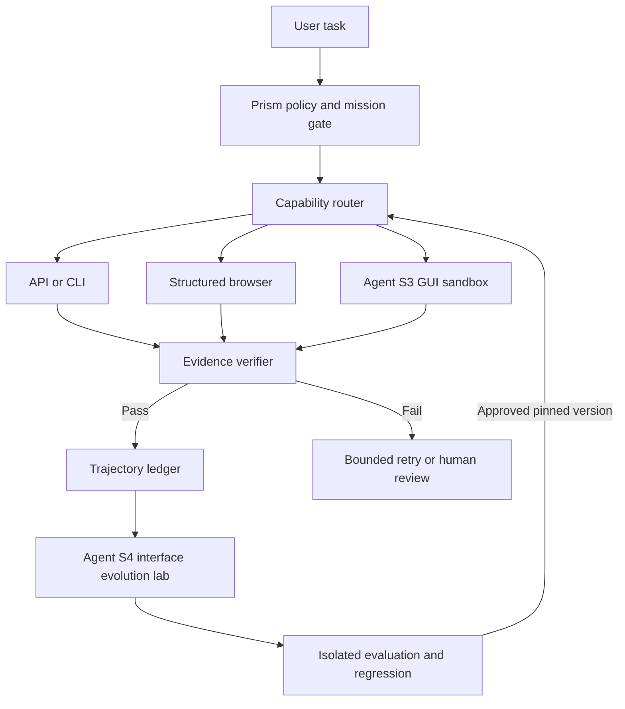

# Agent S3/S4 × Prism: architecture and evaluation

Status: proposal only; no runtime installed or benchmark executed.
Upstream: https://github.com/simular-ai/Agent-S

## Architecture

## Architecture decisions

1. Prefer API/CLI, then structured browser, then GUI. GUI is a fallback, not a universal default.
2. Prism owns policy, task routing, evidence and stop conditions. S3 is a replaceable execution adapter. S4 is an offline experimental interface builder, not an interchangeable S3 version.
3. Every dispatch needs declared OS, allowed apps, permissions, model provider, timeout, budget, input and expected evidence.
4. Run GUI automation in disposable VM or explicitly approved local session. No implicit accessibility permissions, credentials, payment, destructive operations or production deployment.
5. Treat screen text, web content and generated interface code as untrusted. Keep audit logs with secret redaction, bounded retries and an emergency stop.
6. S4 variants require pinned source, separate training/validation/holdout evaluation, safety tests, regression and rollback before promotion.

## Test matrix

| Stage | Evidence | Gate |
|---|---|---|
| Source audit | pinned revision, license, OS and dependencies | reviewed |
| Sandbox smoke | open application, create disposable file, export, handle dialog | all pass |
| Route comparison | same tasks across API/browser/GUI | report success, latency, cost |
| Safety | prompt injection, blocked destructive action, timeout, redaction | all pass |
| Evolution | S4 candidate vs baseline on held-out tasks | no regression, reviewed |

## Current limitations

This document is not an installation, integration, CI test, or proof of execution. The S4 upstream workflow may require benchmark VMs, model credentials and cost budget. No secret should be committed to this repository.

## Open decisions

Approved sandbox environment; model provider and budget; first pilot application and tasks. Detailed adapter contract follows architecture approval.
