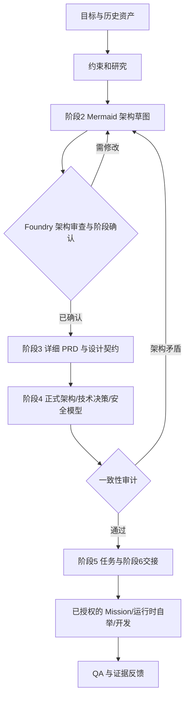
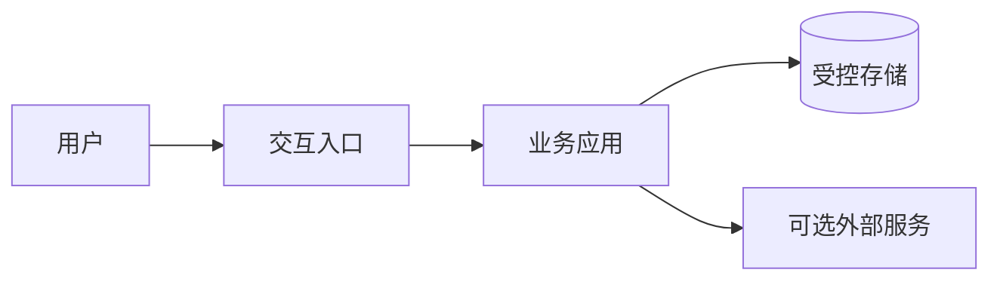
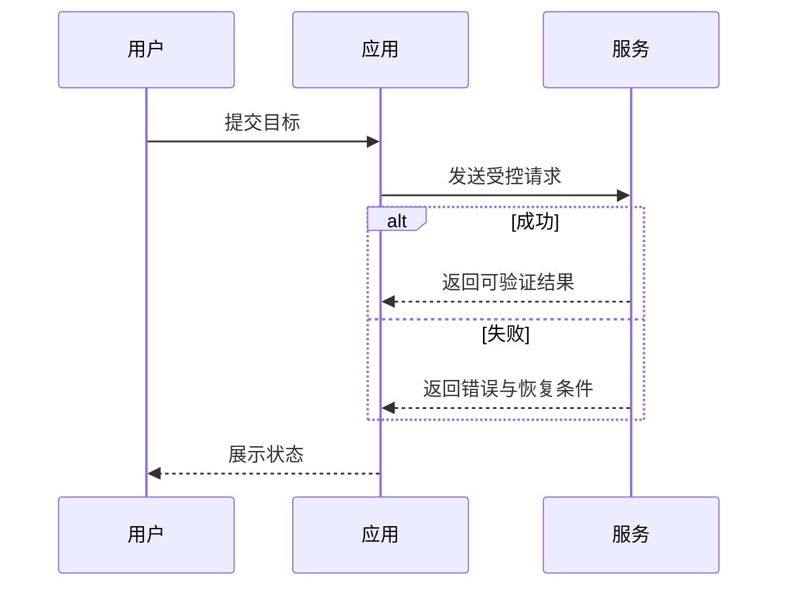

# Architecture First｜Mermaid 架构先行（Prism）

**状态**：集团既有 0–6 规划阶段的前置架构草图检查，不产生第二套合同真相源。真实目标/历史资产/授权仍先于架构；详细 PRD、API、数据库与 Agent 合同必须从经审查的架构基线向下推导。

## 时序与权威

## 架构草图必须回答

1. **目标和范围**：当前要验证的最小用户闭环；不解决什么；已有资产与不可变约束是什么。
2. **系统边界**：客户端、后端、数据、外部服务、Agent、权限边界；仅画适用组件，不凭空增加数据库/微服务。
3. **数据流**：输入、处理、输出、持久化、异步、错误与恢复；用 Mermaid `flowchart`，复杂交互另用 `sequenceDiagram` 或 `stateDiagram-v2`。
4. **方案取舍**：至少解释最小方案与主要替代方案，何时需要扩展；未知标 HYP/UNKNOWN，不冒充已测试。
5. **风险与否证**：关键失败点、资源/运维成本、权限、安全、性能/一致性与可测试性；列下一验证动作。

## Mermaid 两种图

## 机器闸门与审查

- 新建 Foundry 项目（`architecture_first_schema=1`）在阶段 2 增加 `docs/02-architecture-sketch.md`；只有提交符合最低结构要求的 Mermaid 图、记录适用审查、确认阶段 2，才可进入阶段 3 详细 PRD。
- Mermaid 结构验证入口：`python3 scripts/architecture_gate.py /absolute/project/docs/02-architecture-sketch.md`。检查段落、流程图、边和有界大小，不执行图中指令；不能证明 Mermaid 真正渲染或架构正确。
- 已建 Foundry 项目缺少该版本标记时继续使用原阶段文件清单；不因升级偷偷否决历史批准。新项目/被明确迁移的项目采用新要求。
- 阶段 4 的 `docs/04-architecture.md` 仍是正式技术架构文件；必须解释为何保留或修改阶段 2 假设，避免 PRD 反向绑架架构。引发基础边界变化须通过已有 CHG 机制使阶段 2 及后续确认失效。
- 仅修复已明确范围的小 Bug/常规审计不用重造整套架构，但先读既有架构，保持不变；真正影响领域边界/API/信任关系的变更需回流。
- Mission `docs/prism-mission/GOAL.md` 是目标/授权记录，**不是详细 API 或系统契约**。新项目执行前读取已经审过的架构草图；无现有批准基线不得为了赶进度让自动依赖安装、编码或部署越过架构门禁。
- 验证依次为：结构检查 → 作者自检/SA/CTAB/QA（真实执行者）→ 本阶段明确确认 → 下游契约生成 → 实际功能/安全测试。没有真实独立审查者保持 REVIEW_PENDING/自检，不伪造批准。

## 不适用与范围

纯研究型 CTF/REA、零架构变动的 bugfix、只读产品审计不强迫画新图。集团 SkillHub Registry 继续唯一掌握路由，`idea-to-blueprint` 是 0–6 方法权威，Prism 的 Foundry 只是特定阶段机器闸门，不建立平行产品治理系统。
