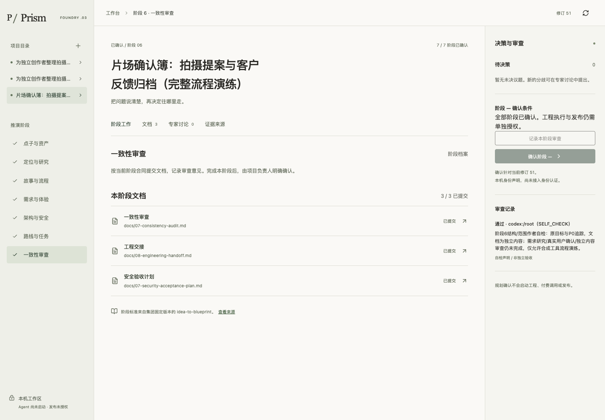
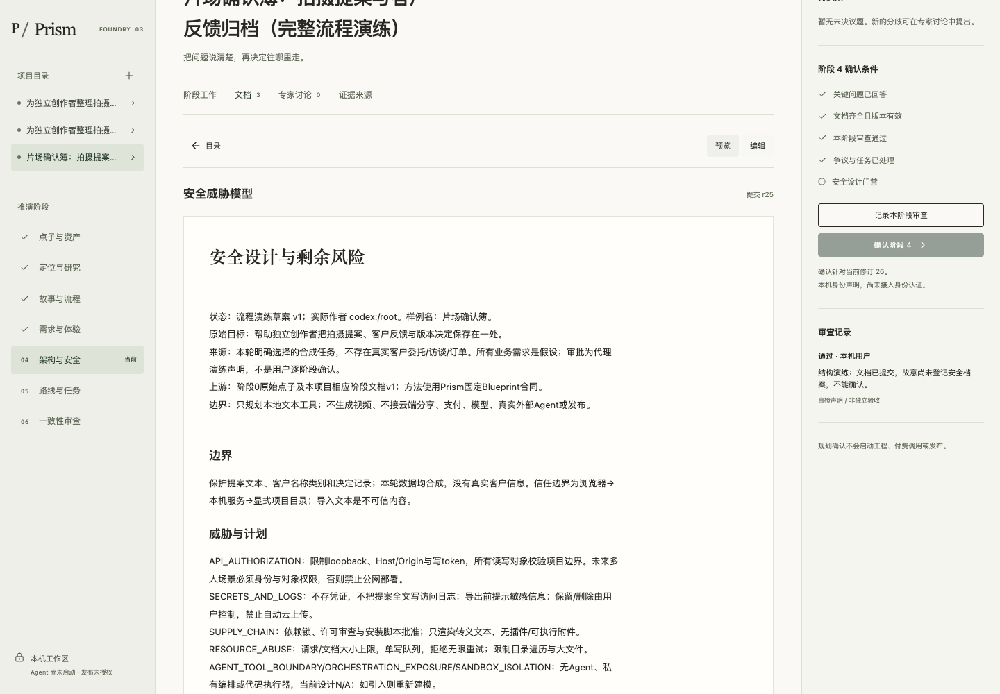

# 完整项目实跑审查：V0.3尚未通过完整验收

2026年10月27日。审查目标源码 f94c32d69483a82fcbd71a34cd810e2b64b434a8。本轮只运行、取证和审查，没有修产品源码、改变权限门禁或合并/部署。

## 结论

**混合网页+CLI的七阶段结构演练通过；纯网页闭环、完整集团合同交接和正式产品蓝图尚未通过。**

| 层级 | 判定 | 实际发生 |
| --- | --- | --- |
| 0–6结构流程 | PASS | 新建片场确认簿合成项目，16份不同阶段文档通过网页编辑提交，7阶段演练声明，状态修订51、BLUEPRINT_READY；39次网页写动作，浏览器0 pageerror。 |
| 完整网页工作流 | BLOCKED | 阶段4的5项安全档案和7项威胁处置没有输入界面，真实HTTP400拒绝后只能CLI补录；handoff也是CLI导出。 |
| 集团辅助合同 | FAIL | 6份辅助文档通过本机文件写入；不在网页/API白名单、阶段SHA登记和handoff索引中。复制项目中移走全部6份后仍BLUEPRINT_READY且交接exit0。 |
| 刷新/进程重启恢复 | PASS | 每阶段刷新读回；两个全新本机服务进程读回相同revision51及有效文档摘要。 |
| 已登记文档篡改与变更回流 | PASS | 独立复制项目外改PRD后交接exit2；接受feature变更后重开阶段3并失效下游，交接exit2。原完成样例保持有效。 |
| 任务合同 | 局部PASS | 独立复制件可登记→同一实际执行者领取→交付文稿；没有外部Agent，不称多Agent执行。 |
| 正式规划/工程批准 | BLOCKED | 七次都是明确标记TEST_PROXY的代理演练声明；真实需求研究、用户逐阶段确认及工程授权均未发生。 |

## 本轮完整样例

样例名称“片场确认簿：拍摄提案与客户反馈归档（完整流程演练）”。实际项目在本机 work/browser-projects/5c77014a89b1eac1，当前revision51。私有原始项目目录/完整文稿不上传本仓；本目录只保存合成样例的统计、摘要、代表截图与审查结论。

16份阶段文件分别覆盖点子/资产、研究、故事/状态、PRD/设计、架构/技术/威胁、路线/看板/DoD、一致性/交接/安全验收。22份文稿全部有不同摘要。另6份为00-planning-state、risks-and-decisions、requirements-traceability、TODO、05-AGENTS-draft、05-CLAUDE-draft；它们由本机脚本直接放入样例，不能算作通过网页完成。

全部内容明确是合成情境。市场需求为HYP，未编造客户访谈、竞品价格、采用或订单。意见由同一执行者手动录入；七阶段声明明确“不是用户本人”，并没有假冒用户确认或独立专家。

## 三项优先缺口

1. **P1 网页流程在安全阶段断开。** UI只能查看摘要，缺5项档案和7项威胁的录入/处置，且缺交接操作。应在原API/CLI状态机上补表单、失效重审和导出，不另建方法论或客户端状态机。
2. **P1 集团完整合同未被机器门禁覆盖。** 六份辅助合同不能通过UI访问；移走后仍可交接。需复用原Blueprint合同登记适用文档、在阶段/交接检查缺失及版本，并将完整索引和摘要带入交接。原HANDOFF只列16路径，本身不含逐文档摘要；不能称锁定全部集团规划文件。
3. **P1 BLUEPRINT_READY容易被误读为真正批准。** 这次文档明确保留需求未知/用户未确认/工程未授权，机器仍可到达READY。当前机制校验声明和结构，未认证审批或判定文档语义。正式验收仍要真实阶段确认和独立内容审查；本轮不补签。

以上是审计发现与修复方向，本轮没有修改源码来消除或掩盖它们。

## 证据

- outcome.json：实际样例与统计；document-manifest.json：22份文稿摘要，避免把重复占位文件当完整内容。
- evidence-summary.json：门禁正反例、复制件回流和辅助合同缺失的真实结果；restart-readback.json：两个新服务进程相同快照摘要。
- independent-review.md：独立principal codex:/root/ui_review的只读UI/状态/文档检查；明确其未重放的部分，不把主执行者测试当独立执行。
- completed-sample.png：完成样例；stage4-blocked.png：完整阶段文档与自检仍不能跳过安全档案。
- 原始动作、CLI输出、阶段快照、交接包和负测复制件保存在忽略的work/full-project-20261027；没有外发真实产品材料。

