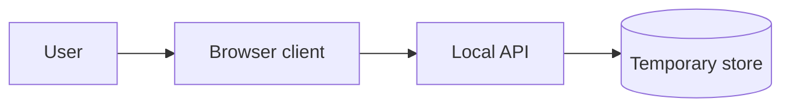
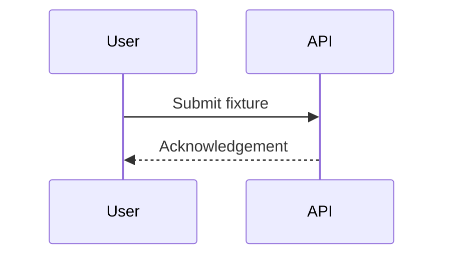

# Architecture Sketch — synthetic fixture

## 目标
验证一个最小可运行的客户端到服务端流程。该图仅是测试数据。

## 系统边界
浏览器是不可信输入；服务在测试工作区内；存储仅含临时数据。

## 数据流
输入经过服务校验后存储；失败时返回受限错误码。

## 取舍
选用单体最小实现以降低状态协调成本；不引入消息队列。

## 风险与假设
假设只在本地运行；没有真实用户、吞吐或部署证据。断电恢复需要后续测试。
